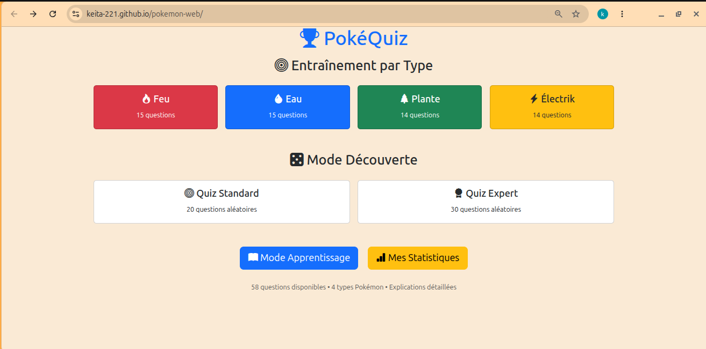
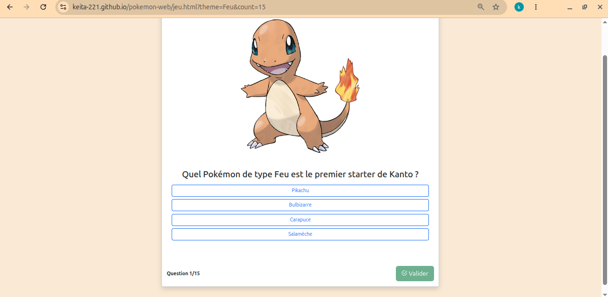
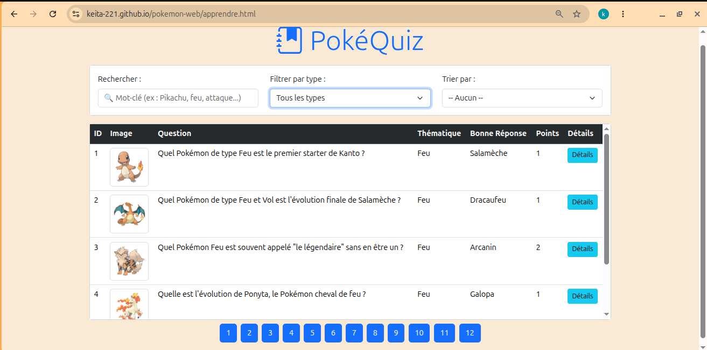
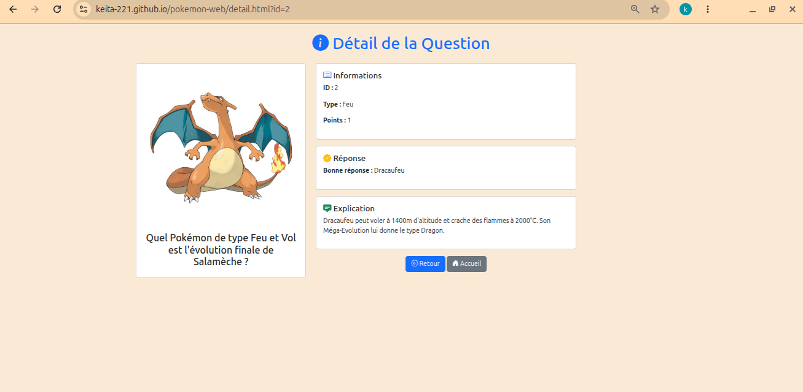

# 🎮 Quiz Pokémon

Application web de quiz sur l'univers Pokémon, réalisée dans le cadre d'un projet universitaire de **développement web côté client**.

**👉 [Essayer le site en ligne](https://keita-221.github.io/pokemon-web/)**

---
## 📸 Aperçu

| Accueil | Jeu |
|---|---|
|  |  |

| Mode Apprendre | Détail d'une question |
|---|---|
|  |  |

## ✨ Fonctionnalités

- 🎯 **Jeu de quiz** avec choix de la thématique et du nombre de questions
- 📚 **Mode « Apprendre »** : tableau de toutes les questions avec pagination, filtre, recherche et tri
- 🔍 **Page de détail** pour chaque question
- 📊 **Statistiques** : historique des scores sous forme d'histogramme coloré
- 💾 **Sauvegarde locale** des scores dans le navigateur (`localStorage`)

## 🛠️ Technologies

| Domaine | Outils |
|---|---|
| Structure et style | HTML5, CSS3, Bootstrap 5 |
| Logique | JavaScript (sans framework) |
| Données | Fichier XML (`data/bdd.xml`, 58 questions) lu avec `XMLHttpRequest` |
| Graphique | Élément `<canvas>` pour l'histogramme |

## 📁 Structure du projet

```
projetweb/
├── index.html          # Accueil : choix du thème
├── jeu.html            # Interface de jeu
├── apprendre.html      # Tableau des questions
├── detail.html         # Détail d'une question
├── statistiques.html   # Histogramme des scores
├── css/                # Feuilles de style
├── js/                 # Scripts (jeu, apprendre, détail, statistiques)
└── data/bdd.xml        # Base de questions
```

---

## 📖 Manuel d'utilisation

### 🎯 Le jeu

1. Depuis l'accueil, choisis un thème (Feu, Eau, Plante, Électrik) ou toutes les questions.
2. Clique sur **Démarrer**.
3. Sélectionne une réponse parmi les quatre propositions (elle devient bleue, tu peux changer d'avis).
4. Clique sur **Valider** :
   - 🟩 la bonne réponse devient verte ;
   - 🟥 ta mauvaise réponse devient rouge ;
   - ⬜ les autres deviennent grises.
5. Clique sur **Suivant** pour continuer jusqu'à l'écran de résultat.

**Paramètres dans l'adresse** : `jeu.html?theme=Feu&count=15`

| Paramètre | Rôle | Exemple |
|---|---|---|
| `theme` | Thème des questions (`all` pour tous) | `theme=Eau` |
| `count` | Nombre de questions | `count=15` |

**Score final** et message selon ta performance :

| Résultat | Message |
|---|---|
| ≥ 80 % | Excellent ! Maître Pokémon ! |
| 60 – 79 % | Bien joué ! Continue ! |
| 40 – 59 % | Pas mal ! Entraîne-toi ! |
| < 40 % | Courage ! Tu peux ! |

Les réponses sont **mélangées aléatoirement** à chaque question, et le bouton **Rejouer** relance une partie avec les mêmes paramètres.

### 📚 L'interface « Apprendre »

Le tableau charge automatiquement toutes les questions depuis le XML et affiche pour chacune : l'ID, l'image, le contenu, la thématique, la bonne réponse, les points et un lien **Détails**.

- **Pagination** : 5 questions par page, avec boutons numérotés.
- **Filtre** : menu déroulant des thématiques (« Tout » pour tout afficher).
- **Recherche** : mot-clé dans le contenu, la thématique ou la bonne réponse, compatible avec le filtre.
- **Tri** : par nombre de points croissant, sur les questions filtrées ou recherchées.
- **Détails** : la page complète d'une question (image, thématique, contenu, réponse, points, explication).

### 📊 Les statistiques

Chaque partie terminée est enregistrée dans le `localStorage` du navigateur (date, score, score maximum, thème) et affichée sous forme d'**histogramme** :

| Couleur | Performance |
|---|---|
| 🟢 Vert | ≥ 80 % de bonnes réponses |
| 🟡 Jaune | entre 50 % et 79 % |
| 🔴 Rouge | < 50 % |

Chaque barre indique le score (X/Y), la date et l'heure, et le thème. Le bouton de suppression efface tout l'historique.

---

## 💻 Lancer le projet en local

Le XML est chargé avec une requête HTTP : ouvrir `index.html` par double-clic **ne fonctionne pas** (blocage CORS). Il faut un petit serveur local.

**Avec VS Code** : installer l'extension *Live Server*, puis clic droit sur `index.html` > *Open with Live Server*.

**Avec Python** :

```bash
git clone https://github.com/Keita-221/pokemon-web.git
cd pokemon-web
python3 -m http.server 8000
```

Puis ouvrir <http://localhost:8000>.

## 📝 Notes

- Projet académique, sans but commercial.
- Les images proviennent de `assets.pokemon.com`. Pokémon et ses personnages sont des marques de The Pokémon Company / Nintendo.

## 👤 Auteur

## 👤 Auteur

**Ibrahima Keita** : étudiant en 3ᵉ année de Licence Informatique Fondamentale et Appliquée (IFA).
[Profil GitHub](https://github.com/Keita-221)